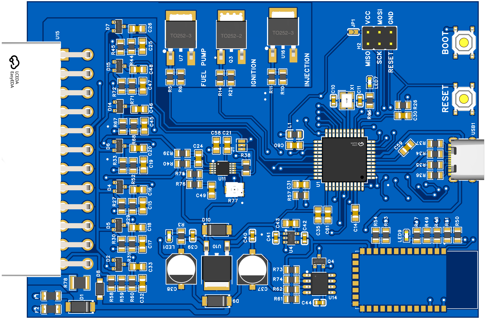

  <picture>
    <source media="(prefers-color-scheme: dark)" srcset="logo-dark.png">
    
  </picture>
  
Open Source

  <h2>Engine Control Unit</h2>

  
  
  
  
  
  
  

  <b>An open-source, DIY-friendly Engine Management System (ECU) based on ATmega32U4.</b>

---

  <picture>
    
  </picture>

## About

ZTech ECU is an open engine management system – hardware, firmware and
configuration in one place. Tuning is done through TunerStudio, and flashing is done conveniently over USB. The goal is an affordable, simple, reproducible ECU for hobbyists and enthusiasts.

## ✨ Features

### 🔥 Ignition
- **Hardware-precise timing:** timer output compare fires the coil with 0.5 µs resolution, independent of the main loop
- **Ignition map** with 12 RPM breakpoints up to 12,000 RPM, fixed timing while cranking
- **Battery-compensated dwell** with a hard limit to protect coil and IGBT
- **Per-tooth tracking:** spark timing is refined on every tooth as RPM changes

### ⛽ Fuel Injection (Alpha-N)
- **VE table** over throttle position × RPM
- **Corrections:** warm-up, cranking enrichment, after-start, acceleration, intake air temperature
- **Injector dead time** compensated for battery voltage
- **Fuel pump control** with prime on key-on and shutdown when the engine stops
- **Limp-home mode** on TPS failure with a fixed throttle value

### ⚙️ Crank Decoder
- **Flexible trigger wheels:** single tooth, 4-1, and 5–32 teeth with 1 or 2 missing
- **VR or Hall sensor**, selectable trigger edge
- **Robust sync:** gap detection against the neighbor average, stable even with compression-induced speed swings while cranking
- **Noise filtering** at standstill and while running, with a sync-loss counter

### 🌡️ Sensors & Diagnostics
- TPS (optional second sensor for plausibility check, also counter-rotating), coolant and intake air temperature, battery voltage
- **IAT optional:** runs without an intake air sensor
- **Fault detection:** open and short circuit on all sensors, with fallback values
- **Bench mode:** all outputs stay safely off when powered by USB only
- **Watchdog:** the ECU restarts within 500 ms if the firmware hangs

### 💻 Tuning with TunerStudio
- **USB and Bluetooth simultaneously:** two equal communication channels
- **Automatic Bluetooth setup:** HC-05 baud rate and device name configured
- **Live data, datalogging and table editors**, one-click TPS calibration
- **Power-fail safe storage:** two alternating EEPROM slots with checksum, so a power loss during burn can't corrupt your tune

### 🧩 Under the Hood
- **ATmega32U4** @ 16 MHz, C++17, no heap, no floating point
- **USB** via LUFA (CDC), firmware updates through the DFU bootloader
- **Non-blocking design:** all time-critical tasks run on interrupts and timer hardware

## Inputs & Outputs

| Channel  | Function                           | Notes                                   |
|----------|------------------------------------|-----------------------------------------|
| **IGN**  | Ignition coil driver               | 1× output · no need for external CDI    |
| **INJ**  | Injector driver                    | 1× output · high-impedance injectors only |
| **FP**   | Fuel pump driver                   |                                         |
| **TPS**  | Throttle position sensor           | Hall or potentiometer (1- or 2-track)   |
| **CKP**  | Crankshaft position sensor         | Hall or VR                              |
| **WSS**  | Wheel speed sensor                 | Hall                                    |
| **CLT**  | Coolant / engine temperature       | NTC thermistor                          |
| **IAT**  | Intake air temperature             | NTC thermistor                          |
| **VBAT** | Battery voltage sensing            |                                         |

Hall = Hall-effect sensor · VR = variable reluctance · NTC = negative-temperature-coefficient thermistor

## 🛠️ Building & Flashing

### Requirements
- [Microchip Studio 7](https://www.microchip.com/en-us/tools-resources/develop/microchip-studio) (AVR-GCC toolchain included)
- Atmel DFU bootloader on the ATmega32U4 (factory default)

### Flash via USB (DFU)
1. Hold **BOOT**, press and release **RESET**, then release **BOOT**
2. The device shows up as *ATmega32U4* (DFU) in the Device Manager
3. Flash with the tool **Atmel Mega DFU**

> ⚠️ **Don't flash via ISP.** Programming over ISP erases the whole chip, bootloader included.
> If the bootloader gets lost, restore it once via ISP and set the lock bits to `0xEF`.

### First Start
After a firmware update with a new EEPROM layout version, the ECU loads default values.
Connect TunerStudio, **use the values from your project**, and burn them to the ECU.

## 📊 TunerStudio Setup

1. Create a new project and select `mainController.ini` as the ECU definition
2. Connect via the ECU's USB COM port, or via Bluetooth after pairing **"ZTech ECU"**
3. Calibrate the throttle: **Tools → Calibrate TPS**
4. Set up the trigger wheel under **Basic → Trigger / Crankshaft**

## Documentation

Full documentation coming soon.

## Flashing the firmware

> [!WARNING]
> Flash the firmware **over USB DFU Bootloader only** – no ISP erase, or the bootloader will be
> lost. Enter bootloader mode only via the BOOT button.

## Contributing

Issues and pull requests are welcome.

## License

Released under the GPL-3.0 license.
